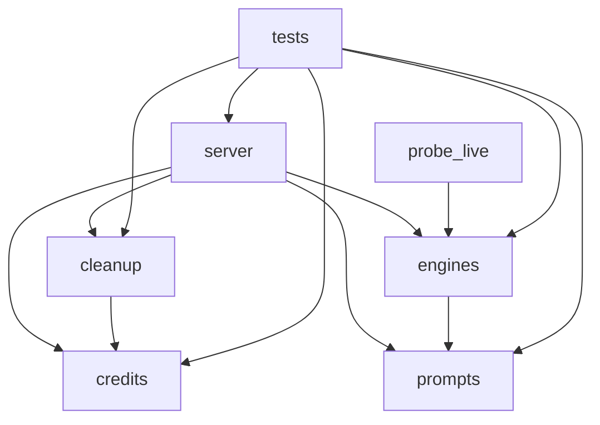

# Architecture

One-page map. Enforced by `scripts/structure.py` (run it via `scripts/check.sh`).

## Purpose

Self-serve single-photo editor: upload one photo + an instruction, get an edited
photo back. FastAPI serves both the JSON API and the static UI. Free tiers only.

## Components

| Path | Role |
|---|---|
| `api/prompts.py` | Preset → prompt templates, identity invariants |
| `api/credits.py` | SQLite ledger (`users`, `jobs`), atomic debit + refund |
| `api/engines.py` | Image-edit providers behind `Engine.edit() -> png bytes` |
| `api/cleanup.py` | Expiry sweep of job artifacts |
| `api/server.py` | FastAPI app, routes, slots, background job thread |
| `api/probe_live.py` | Manual live-provider probe, never part of the app |
| `web/` | Static UI (HTML/CSS/JS), talks to same-origin `/api/*` only |

## Layers

Imports go **strictly downward**. Siblings never import each other.

```
L3  api/test_*.py, api/probe_live.py      anything below
L2  api/server.py                         L1 + L0
L1  api/cleanup.py                        credits
    api/engines.py                        prompts
L0  api/prompts.py, api/credits.py        nothing inside the package
```



## Where new code goes

- Route or request handling → `api/server.py`. It stays the only HTTP layer.
- Provider call → `api/engines.py`, behind the existing engine interface.
- Prompt/preset wording → `api/prompts.py`.
- Quota or debit logic → `api/credits.py`.
- Browser code → `web/app.js`; no secrets, no absolute API host.
- A **new** `api/` module is an architecture change: assign it a layer in
  `scripts/structure.py`, add it to the table above, then pass `check`.

## Must never happen

- A credential in `web/`, in git, or in a URL. Keys live in backend env only.
- An upstream provider call when credits are 0 (check-then-debit first).
- A lower layer importing a higher one (`prompts` importing `engines`).
- A test or check weakened to make CI green (see `docs/AI_WORKFLOW.md`).
- A second database or a second HTTP framework.

## Known debt (ratcheted, not fixed)

- 234 `mypy --strict` findings and 22 ruff findings, frozen in `.ai/baseline.json`.
  Files may only improve; new files start at zero. Fix them opportunistically
  when you touch a file, then re-freeze with `python scripts/ratchet.py --update`.
